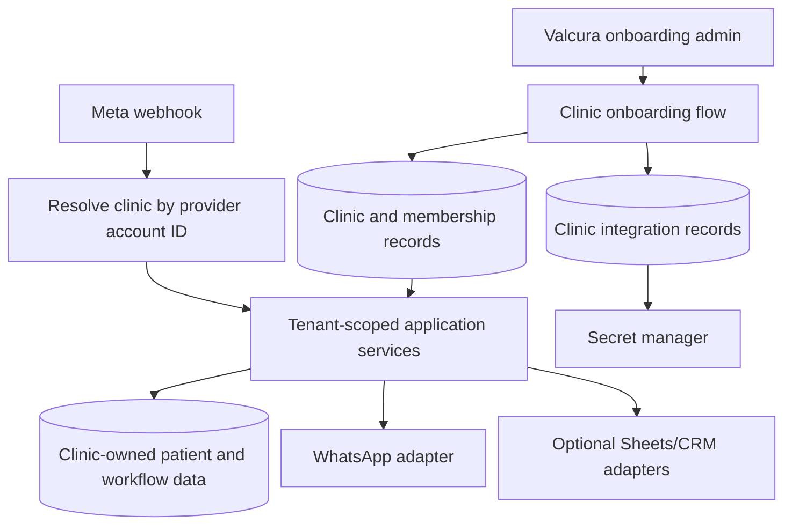

# Valcura Clinic Onboarding

This guide has two tracks:

1. A 1–2 clinic alpha using the current Django implementation.
2. The recommended onboarding and architecture for scaling beyond the alpha.

The alpha steps do not provide full tenant isolation. Do not use them to process real patient data from multiple clinics until the isolation work in the future architecture section is complete.

## 1. Alpha: Onboard One or Two Clinics Today

### What the current system supports

- `/register/` creates a `ClinicProfile` and its first clinic admin in one transaction, then logs the admin in.
- Clinic profile fields and clinic name are saved in the database; clinic names do not need to be added to a source-code list.
- Clinic staff, patients, opportunities, and monthly metrics have clinic relationships in the current data model.
- WhatsApp and Google Sheets integrations are configured globally from one backend `.env` or the hosting platform's environment settings.

### Alpha limitations

- Both clinic profiles use the same `WHATSAPP_ACCESS_TOKEN` and `WHATSAPP_PHONE_NUMBER_ID` and the same configured Google Sheets integration. The app cannot configure different WhatsApp accounts or spreadsheets per clinic yet.
- The inbound WhatsApp webhook does not identify a clinic from Meta's `phone_number_id`. It saves `MessageLog` records without a clinic relationship.
- `WorkflowState` is unique by phone number, not by clinic. Do not reuse a patient phone number across alpha clinics.
- `/api/messages/` currently returns all message logs to any authenticated user. Do not expose this endpoint to clinic users with real data before it is scoped.
- The staff-user form accepts a clinic selection. A clinic admin must not be allowed to create users for another clinic until the server enforces the admin's own clinic.
- Clinic IDs are generated from the first 10 alphanumeric characters of the clinic name. Names with the same normalized prefix can collide even if the names differ.
- The registration route is publicly reachable and has no approval/invitation gate. Use it only in an isolated alpha environment; do not leave open self-registration enabled for production.

### A. Prepare an isolated alpha environment

1. Choose a non-production database and Meta/WhatsApp test setup. Confirm which database `DATABASE_URL` points to before running migrations or creating clinics.
2. Activate the repository virtual environment and move to the Django project directory:

   ```powershell
   cd "D:\MY REPO\Valcura\Valcura_backend"
   ..\myenv\Scripts\Activate.ps1
   ```

3. Django loads environment values from `Valcura_backend/.env` in local development, because `settings.py` uses the backend directory as `BASE_DIR`. Hosting environment variables can be used instead. Keep the file private and out of source control. Do not create a separate `.env` for each clinic.
4. Set the shared alpha credentials once. The current code reads these names:

   - `DJANGO_SECRET_KEY`, `DEBUG`, `ALLOWED_HOSTS`, and `DATABASE_URL`
   - `WHATSAPP_ACCESS_TOKEN`, `WHATSAPP_PHONE_NUMBER_ID`, `WHATSAPP_API_VERSION`
   - `WHATSAPP_VERIFY_TOKEN` for Meta's webhook verification
   - Either `GOOGLE_SHEETS_WEBHOOK_URL`, or `GOOGLE_SHEETS_SPREADSHEET_ID` plus `GOOGLE_SERVICE_ACCOUNT_FILE` or `GOOGLE_SERVICE_ACCOUNT_JSON`
   - `GOOGLE_SHEETS_PATIENT_SHEET` when using the Sheets API

   Note: `WORKFLOW.md` calls the webhook verification setting `WHATSAPP_WEBHOOK_VERIFY_TOKEN`; the current webhook view reads `WHATSAPP_VERIFY_TOKEN`. Use the name expected by the code unless you update the implementation.

5. Run the Django checks and apply migrations against the alpha database:

   ```powershell
   python manage.py check
   python manage.py migrate
   ```

6. Start the local server:

   ```powershell
   python manage.py runserver
   ```

### B. Register the alpha clinic(s)

1. Open `http://127.0.0.1:8000/register/`.
2. Complete the clinic fields: clinic name, city, locality, clinic type, chair count, primary specialty, monthly revenue baseline, reception team size, CRM status, Valcura plan, and onboarding date. CRM name and integration mode can be left blank if not used.
3. Enter the first clinic admin's username, email, and password. Registration creates the clinic and admin together and signs in the new admin.
4. Repeat the registration once for a second alpha clinic if needed. Use clearly different names whose first 10 alphanumeric characters differ, to avoid the current name-derived clinic ID collision.
5. Sign out and log in with each clinic admin. Confirm each dashboard uses the clinic profile associated with that admin.
6. Keep test patients and phone numbers unique between clinics. Use synthetic/test records only. The webhook does not associate incoming events with a clinic, so a message sent through the shared WhatsApp number is not a reliable clinic-specific test.

The clinic name shown to users is read from the clinic record. No code change or environment variable is needed to add a clinic name.

### C. Alpha acceptance checklist

- Each alpha clinic has one `ClinicProfile` and one `HospitalUser` with the admin role.
- Each admin can log in and see the expected clinic dashboard.
- Clinic names and clinic IDs are different.
- Test patients use unique phone numbers and synthetic data.
- WhatsApp sends only to approved tester numbers and uses test credentials/templates where available.
- Sheets testing uses an alpha spreadsheet, not a clinic's live patient sheet.
- The alpha team understands that messaging credentials, Sheets integration, inbound webhook handling, and the message API are shared or unscoped today.
- Public clinic registration is disabled or otherwise access-restricted after the alpha signup window.

For the current implementation, two clinic profiles are suitable for testing registration and basic dashboard separation with synthetic records. They are not yet two isolated live tenants. If either clinic requires its own WhatsApp number, its own spreadsheet, or real patient data, complete the tenant-isolation work first.

## 2. Future: Tenant-Aware Clinic Onboarding

### Target architecture

Keep a single Django deployment and a shared PostgreSQL database initially. Organize the code as a modular monolith with clear ownership boundaries, rather than creating a separate deployment or `.env` file for every clinic.




Suggested Django boundaries (these can be separate apps or well-separated modules):

- `clinics`: clinic profile, location, onboarding status, and memberships.
- `accounts`: authentication, roles, invitations, and clinic access rules.
- `patients`: patients, opportunities, appointments, and imports.
- `messaging`: webhook handlers, message records, workflow state, and jobs.
- `integrations`: WhatsApp, Sheets, and CRM provider adapters.

### Tenant data and integration rules

1. Generate a stable UUID for each clinic. Keep `clinic_name` as editable display data; do not derive identity or uniqueness from a name.
2. Associate every clinic-owned record with a clinic, including `MessageLog` and `WorkflowState`. Make workflow-state uniqueness `(clinic, phone_number)` and retain a patient foreign key where possible. Add indexes that start with `clinic` for common tenant-scoped queries.
3. Resolve tenant context from trusted sources only:
   - Authenticated web/API requests: the user's clinic membership.
   - Provider webhooks: a verified provider account identifier such as Meta's `phone_number_id`, mapped to a clinic integration.
   - Never trust a submitted `clinic_id` as authorization by itself.
4. Make every read and write use an explicit clinic scope. The request layer should establish tenant context, and service/repository methods should require it. Add tests that prove one clinic cannot fetch another clinic's users, patients, opportunities, messages, or workflow state.
5. Make messaging and data integrations receive a clinic integration/configuration object. Remove direct reads of tenant-specific settings from the provider service classes.
6. Store provider account IDs and non-secret settings in the database. Store access tokens and private keys in a managed secret store; keep only a secret reference in the database. Encrypt any credential material at rest and limit who can reveal or rotate it.
7. Keep deployment-wide secrets in the environment, such as Django's secret key, database URL, and secret-manager credentials. Clinic names, spreadsheet IDs, phone-number IDs, and per-clinic tokens must not become per-clinic environment variables.
8. Validate webhook signatures, map the provider account ID to exactly one active clinic integration, and deduplicate events using the provider's message/event ID before processing.
9. Keep common approved templates global when appropriate. Store clinic-specific template/account mappings as database configuration, not as clinic-name branches in Python code.

### Recommended onboarding flow

1. **Create clinic:** Valcura staff or an invited clinic owner creates the clinic. The record starts with `onboarding_status = pending` and a generated ID.
2. **Invite owner:** Send a single-use, expiring invitation. The owner sets their password and receives membership scoped to that clinic. Avoid unrestricted public registration.
3. **Collect clinic configuration:** Capture the clinic's operating profile, location/time zone, languages, working hours, specialties, and communication preferences. Validate required values before activation.
4. **Connect providers:** Guide the owner through the approved WhatsApp/Meta connection flow and optional CRM/Sheets connection. Persist provider identifiers in the database and secrets in the secret manager. Show connection status, never the secret itself.
5. **Import and verify data:** Import patients and appointments through a tenant-scoped job. Validate row counts, required fields, consent/communication permissions, and duplicates. Keep an import report and allow a dry run before writing.
6. **Configure workflows:** Apply global defaults, then let the clinic choose supported options and provide clinic-specific values such as display name, address, reception hours, and approved template mappings.
7. **Run a test:** Send a test message to an authorized test number, verify inbound webhook routing, confirm the correct clinic's message/workflow record is written, and verify that another clinic cannot see it.
8. **Activate:** Set the clinic to `active` only after integration checks, data checks, and owner approval pass. Record onboarding events for audit and support.
9. **Operate:** Provide connection health, message delivery/error status, credential rotation, pause/resume, and offboarding/deletion procedures.

An onboarding status model could be `pending`, `profile_complete`, `integration_pending`, `data_import_pending`, `test_pending`, `active`, `suspended`, and `offboarding`. Store progress as clinic data so retries do not require manual code edits.

### Migration path from the alpha

1. Add generated clinic IDs and remove ID derivation from clinic names.
2. Add clinic ownership to messages and workflow state. Backfill existing records carefully; records that cannot be confidently mapped should remain explicitly unassigned for manual review, not be guessed by phone number.
3. Fix tenant authorization: scope `/api/messages/`, force clinic admins to create users only within their own clinic, and scope webhook processing.
4. Add clinic integration records and adapt WhatsApp/Sheets services to use them. Begin with one integration per clinic and preserve a platform-level default only for controlled migration/testing.
5. Add invitation-based onboarding, integration setup, import validation, and activation checks.
6. Add cross-tenant isolation tests and webhook routing tests before enabling real multi-clinic traffic.
7. Migrate the alpha clinics, verify their records and integration ownership, then onboard additional clinics through the same flow. No clinic-name code changes or per-clinic `.env` files should be needed.

## Code References

- Clinic/user/data models: `Valcura_backend/user_request/models.py`
- Registration forms and current clinic ID generation: `Valcura_backend/user_request/forms.py`
- Registration, webhooks, message API, and clinic views: `Valcura_backend/user_request/views.py`
- Current provider credentials: `Valcura_backend/user_request/services.py` and `Valcura_backend/user_request/google_sheets_service.py`
- Environment loading: `Valcura_backend/Valcura_backend/settings.py`
- Existing setup notes: `WORKFLOW.md`


Clinic Onboarding - (To be implemented)
1. Clinics aren't tech specefic so what exact details, do we need for the clinics.
2. For our meta templates, how can we setup an automatic approval, for meta templates.
3. YAML script integration, valcura tech provider setup.
4. Proper planning of multilevel clinic onboarding.

Two issues

1. Receptionists need to fill duplicate data, that they are already filling in CRM.
2. Doctor need to fill in google form so it's a tedious task as well
3. CRM is already there, if we create something similar, we would face backlash. we have to create something complimentary.  - providing integration module 